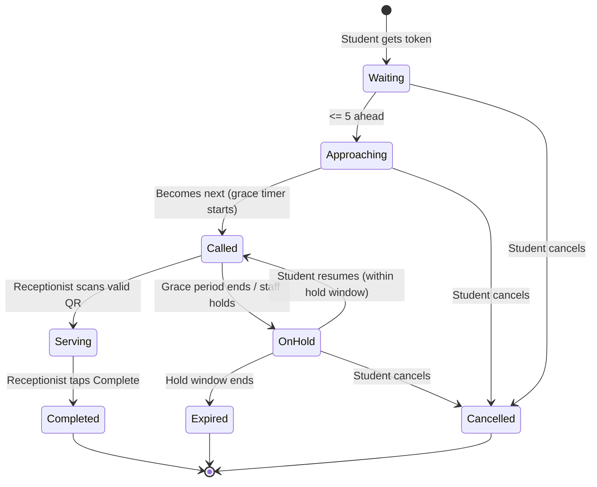
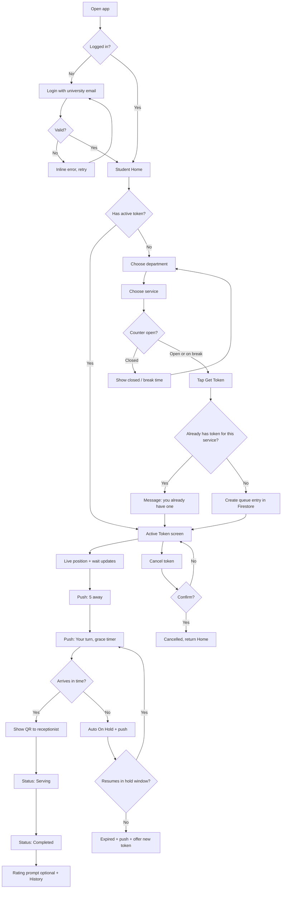
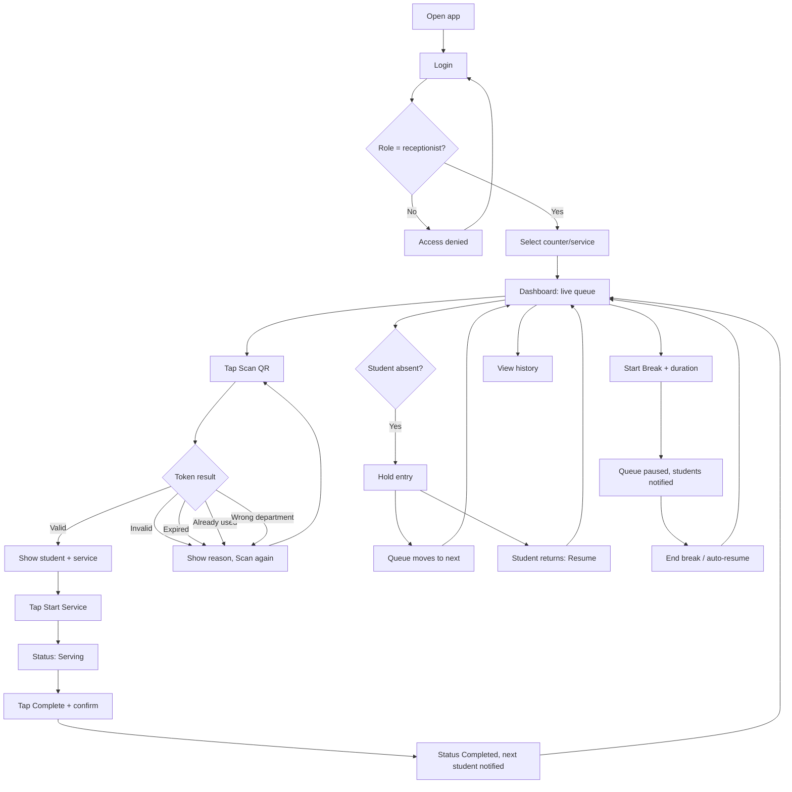

# UniQueue – User Flows (user-flow.md)

Covers every path in the Project 1 scope. Diagrams use Mermaid (renders in GitHub, VS Code preview, and most AI tools).

---

## 1. Queue Entry State Machine (core logic)

Allowed transitions ONLY as above. Any other change must be rejected by the `transition()` function (Reliability NFR).
Display statuses: Waiting, Approaching, Serving, On Hold, Completed, Cancelled, Expired. ("Called" is shown as "Approaching" with "Your turn" banner.)

---

## 2. Student Flow

### Step table
| # | Screen | User action | System response |
|---|---|---|---|
| 1 | Login | Enter email + password | Firebase Auth validates, loads `role`, routes to Student Home |
| 2 | Home | Tap department | Show services with queue sizes |
| 3 | Services | Tap service → Get Token | Create entry, generate token code + QR payload |
| 4 | Active Token | Wait | Firestore listener updates position/status |
| 5 | (Background) | – | FCM at 5 away, next, your turn |
| 6 | Counter | Show QR | Receptionist scans |
| 7 | Active Token | – | Status changes to Serving then Completed |
| 8 | History | Browse | List past entries |

---

## 3. Receptionist Flow

### Step table
| # | Action | Rule |
|---|---|---|
| 1 | Login | Role check; non-receptionists blocked |
| 2 | Scan QR | Validate: exists, active, correct service, not completed, not expired |
| 3 | Start Service | Only valid scanned token can enter Serving |
| 4 | Complete | Confirmation dialog + 10 s Undo; advance queue; notify next |
| 5 | Hold | Start hold window; skip to next student |
| 6 | Break | Set duration; students see return time; no grace timers run during break |

---

## 4. Admin Flow (optional / stretch)

Login → Admin dashboard → Manage departments (add/edit/disable) → Manage services (name, average service time, grace period, hold window) → Manage users (create receptionist, assign department) → View summary stats.

---

## 5. Notification Matrix

| Trigger | Recipient | Title | Priority |
|---|---|---|---|
| Token created | Student | "You're in the queue" | Normal |
| 5 ahead | Student | "5 people ahead" | High |
| Next in line | Student | "You're next" | High |
| Your turn | Student | "It's your turn" | High |
| Grace ending (1 min left) | Student | "1 minute left" | High |
| On Hold | Student | "You're on hold" | High |
| Expired | Student | "Token expired" | Normal |
| Break started/ended | Students in queue | "Counter on break / resumed" | Normal |
| Cancelled by staff | Student | "Token cancelled" | High |

---

## 6. Navigation Maps

**Student:** Login → Home ⇄ Services → Token ⇄ Alerts ⇄ History (bottom nav; Token tab badge when active).
**Receptionist:** Login → Counter select → Queue ⇄ Scan ⇄ History.

---

## 7. Edge Cases (must be handled)

| Case | Behaviour |
|---|---|
| Network lost on student phone | Offline banner, show last cached position; resync on reconnect |
| Network lost on receptionist | Disable Start/Complete, banner "Reconnect to continue" |
| Student double-taps Get Token | Disable button after first tap; server-side duplicate check |
| Same QR scanned twice | "Already used" |
| QR screenshot of old token | "Expired / not valid" |
| Student logs in on 2 phones | Same token shown on both; one QR valid |
| Receptionist ends session mid-service | Entry stays Serving; resumes for next logged-in staff |
| Notification permission denied | In-app banner explains and links to settings |
| Queue empty | "No one waiting" empty state |
| Department closed | Get Token disabled with reason |

---

## 8. Flow Acceptance Checklist
- [ ] Every state transition matches section 1
- [ ] Every failure path shows a message and a way forward
- [ ] No dead-end screens (always a Back/Home/Retry)
- [ ] Role routing works from a single login screen
- [ ] All notifications in section 5 are triggered
